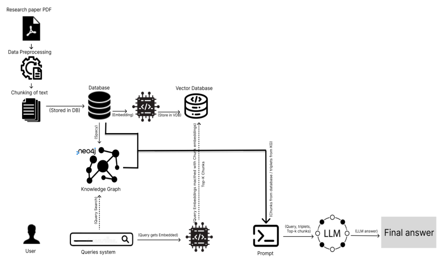
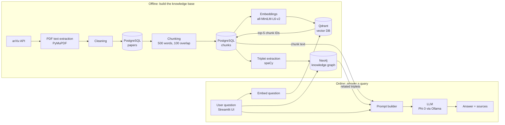

# GraphRAG: A Domain-Aware Knowledge Retrieval System

> Master's thesis project — **MSc Applied Data Science and Analytics, SRH Hochschule Heidelberg (September 2025)**
> Author: **Kshema Iliger** · Supervisors: Prof. Dr. Mehrdad Jalali, Prof. Sina Mehraeen

Ask a question about research papers in plain English and get back a grounded answer, the exact passages it was built from, related facts from a knowledge graph, and links to the original arXiv PDFs.

This repository builds that system end to end and compares two ways of doing it:

- **Baseline RAG** – find the text chunks most similar to the question and give them to an LLM.
- **GraphRAG** – do the same, **plus** add entity–relation–entity facts from a knowledge graph, so the LLM can see how concepts connect.

On a 10-question test set, GraphRAG scored higher on every metric used (BLEU, ROUGE-1, ROUGE-L). Details are in [Results](#results).

---

## Table of contents

1. [Why this project](#why-this-project)
2. [How it works — the big picture](#how-it-works--the-big-picture)
3. [Tech stack](#tech-stack)
4. [The pipeline step by step](#the-pipeline-step-by-step)
5. [Repository structure](#repository-structure)
6. [Getting started](#getting-started)
7. [Evaluation](#evaluation)
8. [Results](#results)
9. [Limitations and future work](#limitations-and-future-work)
10. [Citation](#citation)

---

## Why this project

Large Language Models (LLMs) know only what was in their training data. When asked about specialised or recent material they can **hallucinate** — produce fluent but wrong answers. Finding the right information yourself is also slow: you search several repositories and read long papers.

**Retrieval-Augmented Generation (RAG)** fixes part of this. Before the LLM answers, the system retrieves relevant passages from a trusted collection and tells the model to answer only from them.

Baseline RAG has a weakness: it matches by text similarity only. It struggles when the answer depends on *connecting* facts spread across passages. **GraphRAG** adds a knowledge graph of entities and their relationships, giving the model structured, relational context on top of the raw text.

The thesis asks four research questions:

1. How can LLMs combined with RAG reduce hallucinations while retrieving the most relevant context?
2. Does GraphRAG's entity-to-entity knowledge make answers deeper and more informative than baseline RAG?
3. How does chunking strategy (size and overlap) affect retrieval quality in RAG and GraphRAG?
4. Do knowledge graphs scale to multi-domain exploration, or are they best for specific complex reasoning tasks?

---

## How it works — the big picture



*Figure: System architecture (Figure 10 in the thesis).*

The system has two phases.

**1. Offline — build the knowledge base (run once)**

1. Download research papers from **arXiv** and extract their text from the PDFs.
2. **Clean** the text (remove page numbers, repeated headers/footers, tables, figures).
3. Store papers in **PostgreSQL**, then split each paper into overlapping **chunks**.
4. Turn each chunk into a vector (**embedding**) and store it in **Qdrant** (vector database).
5. Extract **(subject, relation, object) triplets** from each chunk with **spaCy** and load them into **Neo4j** as a knowledge graph.

**2. Online — answer a question (every query)**

1. The user types a question in the **Streamlit** UI.
2. The question is embedded with the same model and Qdrant returns the **top-5 most similar chunks**.
3. The full chunk text is fetched from PostgreSQL.
4. Neo4j is queried for **triplets** related to the question.
5. Chunks + triplets + question are combined into one **prompt**.
6. A local LLM (**Phi-3 via Ollama**) writes the answer.
7. The UI shows the answer, the retrieved chunks, the graph facts and links to the source PDFs.

The same flow as a diagram:



---

## Tech stack

| Layer | Tool | Role |
|---|---|---|
| Data source | arXiv API | Research papers (Machine Learning domain, ~1,900 papers) |
| PDF parsing | PyMuPDF (`fitz`) | Extract text block by block from PDFs |
| Relational DB | PostgreSQL (`psycopg2`) | Store papers, metadata and chunks |
| Embeddings | Sentence-Transformers `all-MiniLM-L6-v2` | 384-dimension vectors, fast and lightweight |
| Vector DB | Qdrant (cloud) | Cosine-similarity search over chunk embeddings |
| NLP | spaCy `en_core_web_sm` | Dependency parsing to extract triplets |
| Graph DB | Neo4j + Cypher | Store and query the knowledge graph |
| LLM | Ollama running `phi3` | Generate the final answer locally |
| UI | Streamlit | Query interface |
| Evaluation | Hugging Face `evaluate`, pandas, matplotlib | BLEU / ROUGE scoring and plots |

---

## The pipeline step by step

### 1. Data collection — arXiv

Papers are fetched from the arXiv API endpoint `http://export.arxiv.org/api/query?search_query=all:<topic>`. Search topics are read from a `topics` table in PostgreSQL. For every paper the script keeps the **ID, title, summary (abstract), authors and link**, then downloads the PDF in memory and extracts its **full text**.

### 2. Cleaning

`clean_pdf_text()` (in `clean_paper.py`) goes through each page block by block and:

- skips images, drawings and figures (non-text blocks);
- joins the lines of a block into one paragraph;
- drops empty blocks and blocks under 3 words;
- drops lines that are just numbers (usually page numbers);
- drops repeated headers and footers;
- drops probable tables (mostly-numeric lines, or many `|` / tab characters);
- removes null bytes.

### 3. Storage in PostgreSQL

Two tables hold the corpus:

| Table | Columns |
|---|---|
| `papers` | `id` (arXiv ID, primary key), `title`, `summary`, `authors`, `link`, `pdf_path`, `full_text` |
| chunk table (`new_chunked`) | `id` (serial), `source_id` (→ `papers.id`), `chunk_index`, `chunk_text` |


### 4. Chunking

Papers are too long to pass to an LLM in one go, so each one is split into chunks of **500 words with a 100-word overlap**:

```python
def chunk_text(text, chunk_size=500, overlap=100):
    words = text.split()
    chunks = []
    i = 0
    while i < len(words):
        chunk = words[i:i + chunk_size]
        chunks.append(" ".join(chunk))
        i += chunk_size - overlap
    return chunks
```

The overlap means a sentence cut at a chunk boundary still appears whole in the next chunk, so no idea is lost. This produced **33,714 chunks**.


### 5. Embeddings and vector search — Qdrant

Each chunk is encoded with `all-MiniLM-L6-v2` (384 dimensions, ~80 MB, very fast) and uploaded to a Qdrant collection called `Master_thesis` with **cosine distance**. Each point's payload stores `postgres_id`, which links the vector back to its text row in PostgreSQL.


### 6. Knowledge graph — spaCy + Neo4j

For every sentence in every chunk, spaCy's dependency parser finds the **subject**, the main **verb** (lemmatised) and the **object**. Each match becomes a triplet such as `(Regularity, use, binding)`. All triplets are written to `triplets.csv` together with their `chunk_id`.


The CSV is loaded into Neo4j with Cypher. `MERGE` makes sure each entity becomes one node, and each triplet becomes a `RELATION` edge:

```cypher
LOAD CSV WITH HEADERS FROM "file:///triplets.csv" AS row
MERGE (s:Entity {name: row.subject})
MERGE (o:Entity {name: row.object})
MERGE (s)-[r:RELATION {type: row.relation, chunk_id: row.chunk_id}]->(o);
```


### 7. Querying

When a question arrives:

1. It is embedded with the same model and Qdrant returns the **top-5** nearest chunks.
2. Their text and `source_id` are fetched from PostgreSQL.
3. Neo4j returns triplets whose entities match the question.


### 8. Prompting

The chunks and triplets are merged into one context block and inserted into a prompt that tells the model to use **only** that context. This strict grounding is the main defence against hallucination. The prompt design refined in the thesis:


### 9. Answer generation

The prompt is sent to Ollama's `/api/generate` endpoint running `phi3`. The UI then shows the answer and a link to the arXiv PDF of every paper the chunks came from, so the reader can check the source.

---

## Repository structure

| File | What it does |
|---|---|
| `config.py` | Reads PostgreSQL connection settings from `database.ini`. |
| `connect.py` | Tests the PostgreSQL connection. |
| `create_tables.py` | Creates the `papers` and `chunked_docs` tables. |
| `insert_papers.py` | Fetches arXiv papers per topic and stores raw full text. |
| `clean_paper.py` | Same ingestion, but with the cleaning step (`clean_pdf_text`). |
| `chunking.py` | Splits every paper into 500-word chunks (100 overlap) → `new_chunked` table. |
| `embed.py` | Embeds all chunks and uploads them to Qdrant. |
| `E&R2.py` | Extracts (subject, relation, object) triplets with spaCy → `triplets.csv`. |
| `triplets.csv` | Extracted triplets, ready to load into Neo4j. |
| `GRAG-UI.py` | **Streamlit app** — the full GraphRAG query pipeline. |
| `E-RAG.py` | Generates **baseline RAG** answers for the evaluation questions. |
| `E-GRAG.py` | Generates **GraphRAG** answers for the evaluation questions. |
| `Final_evaluation.csv` | Questions, reference answers, RAG answers and GraphRAG answers. |
| `Eval.py` | Computes BLEU / ROUGE-1 / ROUGE-L and draws box plots. |
| `visual.py` | Bar chart comparing the average scores. |
| `T-RP-data.py`, `T-view-table-RP.py` | Early prototype using SQLite (kept for reference). |

---

## Getting started

### Prerequisites

- Python 3.9+
- PostgreSQL
- A Qdrant instance (Qdrant Cloud or local Docker)
- A Neo4j instance (Neo4j AuraDB or local)
- [Ollama](https://ollama.com) with the Phi-3 model

### 1. Install

```bash
git clone https://github.com/Kshemaij/GraphRAG_System.git
cd GraphRAG_System

pip install psycopg2-binary requests pymupdf pandas sentence-transformers \
            qdrant-client neo4j spacy streamlit evaluate rouge_score matplotlib tqdm
python -m spacy download en_core_web_sm

ollama pull phi3
```

### 2. Configure

Create a `database.ini` file (used by `config.py`):

```ini
[postgresql]
host=localhost
port=5432
database=thesis
user=postgres
password=<your-password>
```

Then set your own PostgreSQL, Qdrant (URL + API key) and Neo4j (URI, user, password) credentials in the configuration block at the top of each script.

> **Tip:** keep credentials out of the code — load them from environment variables or a `.env` file that is listed in `.gitignore`.

### 3. Build the knowledge base

```bash
python create_tables.py      # create tables
# create a `topics` table with a `name` column and add your search topics
python clean_paper.py        # fetch, clean and store papers
python chunking.py           # split papers into chunks
python embed.py              # embed chunks and upload to Qdrant
python "E&R2.py"             # extract triplets → triplets.csv
```

Load `triplets.csv` into Neo4j with the Cypher query shown in [step 6](#6-knowledge-graph--spacy--neo4j).

### 4. Run the app

```bash
ollama serve                 # if Ollama is not already running
streamlit run GRAG-UI.py
```

Open the URL Streamlit prints, type a question and click **Get Answer**.

---

## Evaluation

Both pipelines were tested on **10 questions**, each from a different paper in the corpus. Questions cover fact-finding, concept explanation and comparison. Reference answers were taken directly from the source papers.

Three automatic metrics compare each generated answer with its reference:

| Metric | What it measures | Level |
|---|---|---|
| **BLEU** | Precision of n-gram overlap (with a brevity penalty) | Phrase |
| **ROUGE-1 F1** | Overlap of single words, balancing precision and recall | Word |
| **ROUGE-L F1** | Longest common subsequence — similarity of structure and order | Sequence |

Run it yourself:

```bash
python E-RAG.py      # baseline RAG answers
python E-GRAG.py     # GraphRAG answers
python Eval.py       # scores + box plots
python visual.py     # summary bar chart
```

---

## Results

| Metric | RAG | GraphRAG | Change |
|---|---|---|---|
| BLEU | 2.11 | **6.16** | ≈ 2.92× (+192%) |
| ROUGE-1 F1 | 0.52 | **0.83** | ≈ 1.60× (+59.6%) |
| ROUGE-L F1 | 0.13 | **0.16** | ≈ 1.23× (+23.1%) |

<!-- <table>
  <tr>
    <td></td>
    <td></td>
    <td></td>
  </tr>
  <tr>
    <td align="center">BLEU</td>
    <td align="center">ROUGE-1 F1</td>
    <td align="center">ROUGE-L F1</td>
  </tr>
</table> -->

**What the numbers mean**

- **ROUGE-1 (0.83 vs 0.52):** GraphRAG answers contain most of the key terms from the reference. Graph triplets hand the LLM explicit entity names and technical terms, which it reuses.
- **BLEU (~3× higher):** GraphRAG's phrasing is closer to the source papers' vocabulary.
- **ROUGE-L (small gain):** both systems structure sentences differently from the references. Even so, GraphRAG's lowest ROUGE-L score is above RAG's median.
- **Manual review:** GraphRAG helps most when the question involves relationships between entities and the answer requires tracing connections — "how" and "why" questions. Its answers are longer and more explanatory; baseline RAG suits short factual lookups.

**Answers to the research questions, in short**

1. Grounding the LLM in retrieved chunks, adding verified graph facts, and a strict "use only this context" prompt together reduce hallucination.
2. GraphRAG adds relational context, which makes answers deeper — especially for multi-hop questions.
3. Chunk size and overlap decide whether relevant text is retrievable, and for GraphRAG also which relationships end up in the graph. Moderate chunks with some overlap balance precision and context.
4. Knowledge graphs are most valuable in focused, reasoning-heavy domains. For broad multi-domain search, a hybrid — vector retrieval first, graph as an enhancer — scales better.

---

## Limitations and future work

**Limitations**

- Built and tested on a single domain (Machine Learning papers from arXiv).
- GraphRAG queries are slower than baseline RAG because of graph lookup.
- Rule-based spaCy triplets are noisy: many subjects are pronouns such as "we", "it" or "that".
- BLEU and ROUGE measure word overlap, not reasoning depth; the evaluation set has only 10 questions.

**Future work**

- **Live retrieval agents** that search the web (e.g. Tavily, SerpAPI, Bing) when the stored corpus is not enough, and merge new results into the knowledge base.
- **Better entity and relation extraction** (LLM-based or with entity linking) for a cleaner graph.
- **Faster graphs:** incremental updates, pruning weak nodes and approximate nearest-neighbour entity linking.
- **Richer evaluation:** semantic metrics, LLM-as-judge and human review.

---

## Citation

If you use this work, please cite:

```bibtex
@mastersthesis{iliger2025graphrag,
  author  = {Kshema Iliger},
  title   = {Developing a RAG based Domain Aware Knowledge Retrieval System},
  school  = {SRH Hochschule Heidelberg},
  year    = {2025},
  month   = {September},
  type    = {MSc Applied Data Science and Analytics}
}
```

### Acknowledgements

Thanks to Prof. Dr. Mehrdad Jalali and Prof. Sina Mehraeen for supervising this thesis, and to the developers of arXiv, Qdrant, Neo4j, spaCy, Sentence-Transformers and Ollama.
